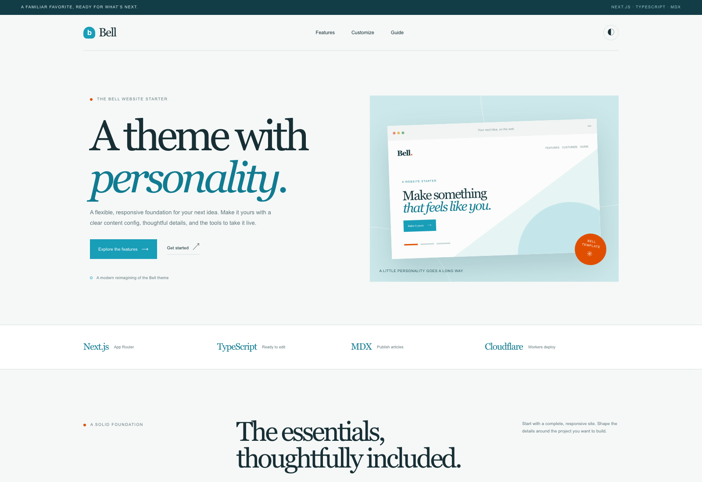
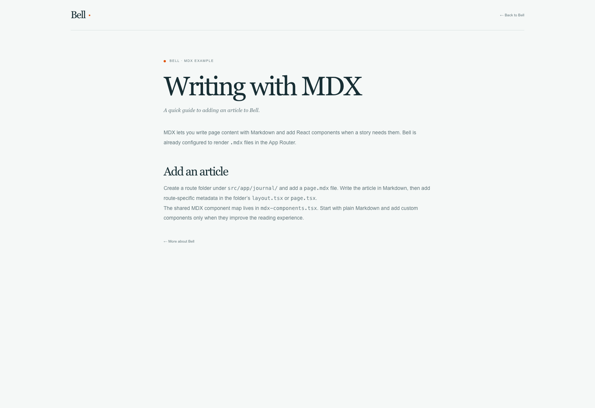

# Bell

Bell is a website theme for giving new projects a confident start. This modern edition keeps the original theme’s personable, flexible spirit and rebuilds it with the Next.js App Router, TypeScript, Tailwind CSS 4, MDX and Cloudflare Workers.



## Screenshots

The landing page includes a working MDX article route:



## Requirements

- Node.js 22.12 or newer
- pnpm

## Develop

```bash
pnpm install
pnpm dev
```

Open `http://localhost:3000` to explore the site. Run `pnpm typecheck` and `pnpm build` to check the project and create a production build.

## Make it yours

Edit `src/content/site.ts` to change the Bell identity, page copy, navigation, feature list, setup commands and links. The page sections are driven by this typed content config. Adjust design tokens and responsive styles in `src/app/globals.css`.

The hero preview and feature copy describe the starter’s included capabilities. Replace them with details that fit the site you build with Bell.

## Add an article

Create an MDX route under `src/app/journal/`, such as `src/app/journal/first-light/page.mdx`. Add route metadata in its `layout.tsx` or `page.tsx`. MDX components are configured in `mdx-components.tsx`.

## Metadata and sharing

The site title, description, social cards, icon and manifest are configured in `src/app/layout.tsx`. The starter uses the reserved `example.com` domain for its canonical URL. Set `site.url` in `src/content/site.ts` to the public site address before deployment; this value also sets the Open Graph URL and sitemap entries. The Open Graph artwork is `public/opengraph-image.svg`, and the App Router generates `robots.txt` and `sitemap.xml`.

## Cloudflare Workers

Bell builds a static export into `out/`. The Worker serves these files through the `ASSETS` binding in `wrangler.jsonc`; no database, runtime API or application secrets are required.

```bash
pnpm preview
pnpm deploy
```

`pnpm preview` builds the site and runs it locally with Wrangler. `pnpm deploy` builds and deploys it; Wrangler must be authenticated to the target Cloudflare account.

The Worker name is configured in `wrangler.jsonc`. Choose an available name for the Cloudflare account used to deploy the site.

This static deployment supports prerendered pages and assets. Request-time rendering, API routes and incremental static regeneration require a server-capable Next.js deployment adapter.

## Contributing

See [CONTRIBUTING.md](CONTRIBUTING.md) for local setup and contribution checks.

## License & Custom Work

[](mailto:work@withrana.com) [](https://www.linkedin.com/in/workwithrana)
[](https://www.upwork.com/freelancers/~01bbcf6edb91a8df5f)
[](https://contra.com/ranajahanzaib/)

**License:** MIT, see [LICENSE](LICENSE). Free for personal and commercial use.

**Author:** Rana Jahanzaib

**Need this built for your stack?** Email me what you're working on: work@withrana.com
